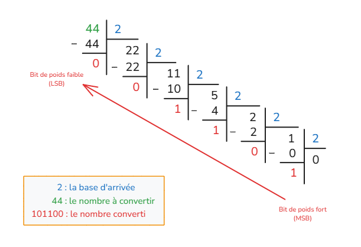
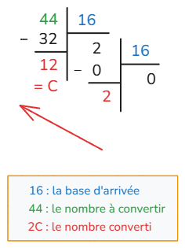

import ConversionBases from '@site/src/components/Entraineurs/ConversionBases';

# Entiers positifs et changements de base

:::objectifs

- Écrire un entier positif dans une base $b \geqslant 2$.
- Passer de la représentation d'une base dans une autre, en particulier entre les bases 2, 10 et 16.

:::

## Représentation des entiers positifs

### Le système décimal (base 10)

Tout le monde sait compter en base 10 (décimal). Mais comment ça marche ? Comment est construit notre système ? Pour répondre à cette question à l'apparence simple, oubliez tout et reprenons depuis le début : comment avez-vous appris à compter à l'école ?

On peut penser que la base 10 vient du fait qu'on a 10 doigts (c'est possible mais pas sûr), mais en tout cas deux choses sont certaines :

- Il y a 10 chiffres : 0, 1, 2, 3, 4, 5, 6, 7, 8, 9.
- Avec ces derniers, on peut compter jusqu'à 9.

Et si l'on veut aller au-delà de 9, il faut changer de rang.

Cela signifie que si le rang des unités est plein, il faut passer à celui des dizaines, puis des centaines, milliers et j'en passe.

Par exemple, le nombre 1234 se décompose comme suit :

4 unités, 3 dizaines, 2 centaines et 1 millier.

On peut alors l'écrire comme suit :

$$
\begin{aligned}
1234 &= 1000 + 200 + 30 + 4 \\
1234 &= 1 \times 10^3 + 2 \times 10^2 + 3 \times 10^1 + 4 \times 10^0
\end{aligned}
$$

:::vocabulaire
Le système décimal est un **système de numération positionnel** en base 10, c'est-à-dire qu'il utilise 10 chiffres (de 0 à 9) et que la valeur d'un chiffre dépend de sa **position dans le nombre**.

- **Base** $b$ : nombre de chiffres différents utilisés pour écrire les nombres (de $0$ à $b - 1$).
:::

### Les chiffres romains

Contrairement au système décimal, les chiffres romains ne sont pas positionnels. La valeur d'un chiffre ne dépend pas de sa position dans le nombre.

Exemple : le nombre 1987 s'écrit en chiffres romains : MCMLXXXVII.
Le X placé en 5ème position vaut 10, mais le X placé en 7ème position vaut aussi 10, donc la valeur d'un chiffre ne dépend pas de sa position dans le nombre.

Chacun des chiffres romains a une valeur fixe et pour obtenir la valeur d'un nombre, on additionne (ou soustrait) les valeurs des chiffres qui le composent.

:::vocabulaire
- **Système de numération positionnel** : système de numération dans lequel la valeur d'un chiffre dépend de sa position dans le nombre.
- **Système de numération additif** : système de numération dans lequel la valeur d'un chiffre est additionnée à celle des autres chiffres, indépendamment de sa position dans le nombre.
:::

### Le système binaire (base 2)

Le système binaire, ou base 2, est le système de numération le plus simple. Il utilise seulement deux symboles, 0 et 1.

:::vocabulaire
Le système binaire est aussi un **système de numération positionnel**.

- **Bit** (*binary digit*) : chiffre de la base 2, qui vaut 0 ou 1.
- **Octet** : groupe de 8 bits.
- **Bit de poids fort** : le bit le plus à gauche (celui qui « pèse » le plus) ; **bit de poids faible** : le plus à droite.

:::

### Le système hexadécimal (base 16)

Le système héxadécimal est un système de numération positionnel en base 16. 

Ce système est utilisé pour :
- Encoder les couleurs en informatique (ex : #FF5733).
- Représenter les adresses mémoire (ex : 0x1A3F).
- Utilisé dans les langages de programmation pour représenter des valeurs binaires de manière plus lisible.

:::vocabulaire
- **Hexadécimal** : base 16, chiffres de 0 à 9 puis A (10), B (11), C (12), D (13), E (14), F (15).
:::

:::retenir
- **Base** $b$ : nombre de chiffres différents utilisés pour écrire les nombres (de $0$ à $b - 1$).
:::

## 📊 Méthode de conversion

### ♻️ Décimal ➜ Binaire / Hexa : division par la base

:::methode De la base 10 vers la base $b$
On divise par $b$ jusqu'à obtenir un quotient nul, puis on lit les **restes de bas en haut**.
:::

> Exemple : 44 en binaire

Le premier bit (le plus à gauche) est le bit de poids fort et le denrier (le plus à droite) est le bit de poids faible.

> Exemple : 44 en hexadécimal

### ♻️ Binaire / Hexa ➜ Décimal : multiplication positionnelle

:::methode De la base $b$ vers la base 10
Chaque chiffre est multiplié par une puissance de $b$, selon sa position (0 à droite).  
:::

$$
\begin{aligned}
&= \textcolor{red}{1} \times 2^5 + \textcolor{red}{0} \times 2^4 + \textcolor{red}{1} \times 2^3 + \textcolor{red}{1} \times 2^2 + \textcolor{red}{0} \times 2^1 + \textcolor{red}{0} \times 2^0 \\
&= 32 + 0 + 8 + 4 + 0 + 0 = 44_{10}
\end{aligned}
$$

> Exemple : $2C_{16}$

***C** se traduit par **12** en décimal*  

$$
\begin{aligned}
&= \textcolor{red}{2} \times 16^1 + \textcolor{red}{12} \times 16^0 \\
&= 32 + 12 = 44_{10}
\end{aligned}
$$

## 🔬 Astuce entre binaire et hexadécimal

:::methode Entre les bases 2 et 16
- 1 chiffre hexadécimal = 4 bits. 
- On regroupe les bits par 4 en partant de la droite.
:::

> Exemple :

| Binaire | Hexa |
| ------- | ---- |
| 0000    | 0    |
| 0001    | 1    |
| 1010    | A    |
| 1111    | F    |

Pour convertir rapidement :

- Groupes de 4 bits ➜ 1 chiffre hexa
- Inversement, chaque hexa ➜ 4 bits

## Entraînements

import QCM from '@site/src/components/Entraineurs/QCM';

<QCM
  question="Les entiers positifs écrits en base 2 et qui se terminent par un 0 sont tous ..."
  choices={[
    { label: 'pairs', isCorrect: true },
    { label: 'impairs', isCorrect: false },
    { label: 'divisible par 3', isCorrect: false },
    { label: 'divisible par 5', isCorrect: false },
  ]}
  explanation="Le dernier bit d'un nombre en binaire est égale à 1 si le nombre est impair et égale à 0 si le nombre est pair."
  theme="serieux"
/>

<QCM
  question="Combien de nombres entiers différents peut-on coder avec 32 bits ?"
  choices={[
    { label: '2^32', isCorrect: true, isEquation: true },
    { label: '2^32 - 1', isCorrect: false, isEquation: true },
    { label: '32^2', isCorrect: false, isEquation: true },
    { label: '32 * 2', isCorrect: false, isEquation: true },
  ]}
  explanation="Pour chacun des 32 bits, il y a 2 possibiltés."
  theme="serieux"
/>

### Conversions

Chaque entraînement tire une nouvelle question à chaque fois : refais-les autant que nécessaire.

<ConversionBases title="De la base 10 vers la base 2" from={10} to={2} />

<ConversionBases title="De la base 2 vers la base 10" from={2} to={10} />

<ConversionBases title="Base 10 et base 16" from="aleatoire" to="aleatoire" bases={[10, 16]} max={4095} />

<ConversionBases title="Base 2 et base 16" from="aleatoire" to="aleatoire" bases={[2, 16]} max={4095} />

### Pour aller plus loin : d'autres bases

La méthode est la même pour toutes les bases $b \geqslant 2$.

<ConversionBases title="Dans une base b quelconque" bases={[2, 3, 5, 8, 10, 16]} max={500} />
